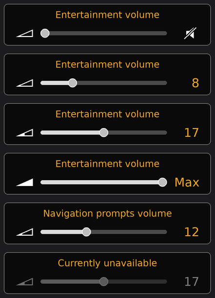
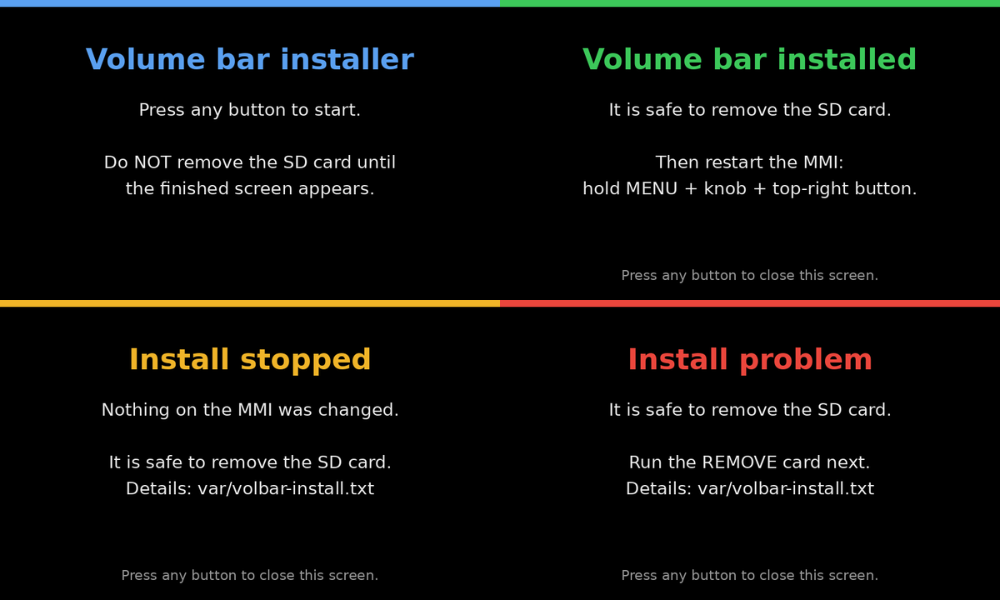

<!--
  Formatting notes (HTML comments like this one don't show up on GitHub):
  - Keep one H1 (the title). Sections are H2, sub-steps are numbered lists.
  - No emoji, no badges. Plain Markdown only so it reads the same on mobile.
  - Paths, file names and commands go in backticks; anything you type goes in a code block.
  - Keep the "Read this first" section right under the picture. People skim.
  - If you add car photos later, put them in docs/images/ and drop them in where the
    PHOTO comments are. Keep each image under about 1 MB.
-->

# MMI3G-VolumeBar

An on-screen volume pop-up for the Audi MMI 3G High, styled after the one Audi added on the 3G+ systems in 2013+ cars. Stock 3G High shows nothing when you turn the volume knob. With this, you get the volume level and which volume you're changing, in the 3G High look.



*Rendered preview of the pop-up states. It looks the same on the car.*

<!-- PHOTO: a shot of the pop-up on the car's screen would go well here. -->

## Read this first

- **Tested on:** 2010 Audi S5 Cabriolet (US), MMI 3G High (HNav), software version HNav_US_K0133_3_D1, navigation database 8R0060884JE NAR 6.24.0. That is the only setup I've tested on. The installer checks for the K0133 screen software and stops without changing anything if it doesn't match.
- **No warranty:** You use this at your own risk. I'm not responsible if something breaks, your MMI acts up, or your dealer gives you a weird look. I can't promise that any code, this or otherwise, is bug-free, but I did my best to make sure everything works as intended on the car.
- **AI disclosure:** This project was created with the assistance of AI (Claude Opus 5.5 by Anthropic). It was designed, directed and tested by me, on an actual car. Everything I've thrown at it works, and there are failsafes (listed below). If AI-assisted projects in your car aren't your thing, this isn't the project for you.

## What it does

- Shows a pop-up every time you turn the volume knob, including at 0 and at the top.
- Shows which volume you're changing: entertainment, navigation prompts, call, ring tone, traffic reports or voice recognition. All entertainment sources (radio, media, Bluetooth) share one volume, so they show as "Entertainment volume", like Audi does it.
- Shows a crossed-out speaker at entertainment volume 0, and "Max" at the top of the scale.
- Shows "Currently unavailable" with a greyed-out bar when the MMI has the volume locked.
- Fades out 3 seconds after your last change, or when you press the knob.
- Disappears right away when you switch screens, unless you're still turning the knob.
- Never shows over the reverse camera.

## Failsafes

- Nothing that came with the MMI is changed. Install adds one file, `/mnt/efs-system/lsd/TestServer.jar`, and remove deletes it again.
- Every hook into the stock volume code is wrapped so that any error falls back to the stock behavior. After 5 errors the pop-up turns itself off until the next restart.
- The install card checks the unit type and the screen software before touching anything, verifies the copy before and after it goes on, and puts the system partition back to read-only when done.
- The cards run from the MMI's own SD card script launcher, not from the screen software that this project changes.

## Install

You need an SD card formatted FAT32. Any size works.

1. Download `MMI3G-VolumeBar-v1.0.0.zip` from the [Releases](https://github.com/evanonym0us/MMI3G-VolumeBar/releases) page and unzip it.
2. Copy everything inside the `volbar-install` folder to the root of the SD card. `run.sh` should sit at the top level of the card, not inside a folder.
3. With the car on and the MMI fully started, put the card in either SD slot.
4. The installer screen appears. Press any button to start.
5. Wait for the green "Volume bar installed" screen, then take the card out.
6. Restart the MMI: hold MENU, the knob and the top-right button together until the screen goes dark.

The pop-up works as soon as the MMI is back up. For the first 20 seconds it ignores volume changes the system makes on its own, so it doesn't pop up while everything starts. The knob works right away.



## Remove

Same steps as installing, using the `volbar-remove` folder. After the MMI restarts it is back to stock.

## Something not right?

Run the `volbar-report` card the same way. It saves `var/volbar-report.txt` and `var/volumebar.log` to the SD card. The log is kept in memory, so run the report **before** you turn the car off, or it's gone. Open an issue and attach both files.

## How it works

The MMI's screen software is Java. On startup, its launch script puts a file called `TestServer.jar` (if it exists) in front of the main software, so classes inside it replace the stock ones. This project uses that slot. It adds the pop-up classes and three slightly changed copies of stock classes that call into the pop-up when the volume changes.

[FINDINGS.md](FINDINGS.md) has the details, plus everything I learned about the MMI 3G High along the way. It might save you time if you're writing your own mods.

## Building from source

The source in this repo doesn't include any Audi code. To build, you copy the screen software off your own car and the build patches that.

You need Linux (WSL works), JDK 8, Python 3, git, curl, zip and unzip. `ksh` is optional and only used to test the SD cards.

1. Make the firmware copy card and run it on the car like the install card:

   ```sh
   ./build.sh firmware-card
   ```

   It writes `dist/volbar-firmware.zip`. It only reads from the MMI.

2. Copy `lsd.jxe` and `lsd.sh` from the card's `var/firmware` folder into a folder named `firmware` in this repo.

3. Build. Point `JAVA8_HOME` at your JDK 8 if `javac` on your path is a newer version:

   ```sh
   ./build.sh
   ```

The build downloads its tools into `deps/` (pinned versions, checked by SHA-256), converts `lsd.jxe` to a jar, compiles, patches, runs the tests and writes the install, remove and report cards to `dist/`. The same source always gives a byte-identical `TestServer.jar`.

## Credits

- DrGER for the SD card launcher (`copie_scr.sh`) and `showScreen`, which the cards use to run and show their status screens.
- luka-dev for [jxe2jar](https://github.com/luka-dev/jxe2jar), which turns `lsd.jxe` into something you can compile against.
- The [ASM](https://asm.ow2.io) project, used to patch the stock classes.
- Audi, for the 3G+ design this copies.

## License

GPL-3.0, with an extra permission that lets the code be combined with the MMI software. See [LICENSE](LICENSE) and [NOTICE](NOTICE). The third-party files in the SD cards keep their own terms.

Not affiliated with or endorsed by Audi, Volkswagen or Harman.
